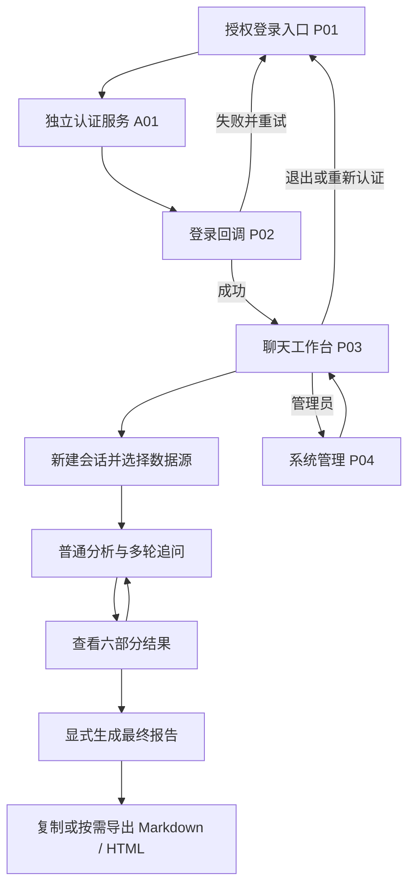

# 经营归因分析系统前端页面说明

> 2026-10-23 用户确认：项目当前仅针对电脑端，不包含移动端使用。本次 M07 仅测试电脑端功能，前端页面布局与视觉效果暂不验收；未验部分不登记为通过。Apple HIG 技能不再适用于本项目。

> 本轮桌面原型还原补充：已按用户要求移除 `.pen` 的 23–25 窄屏画面，追加 28–38 桌面状态，现共 36 个顶层画面。已完成逐页核对与本轮桌面验收，记录见 [验收报告](./docs/design/parity/review.md)；完整逐页图像对照保留在本机验收归档，不随源码提交。当前交付已移除手机端功能与相关测试，业务样例只包含Windows/macOS电脑；最新文字同步及范围见 [本轮记录](./docs/design/desktop-only/review.md)。

> 2026-10-24 最新要求：全部使用固定浅色主题，不跟随系统深色设置。该要求同时适用于前端页面、独立授权页面及原型文件；下文涉及深色外观的旧要求不再适用。

| 项目 | 说明 |
| --- | --- |
| 编写日期 | 2026-10-23 |
| 需求依据 | [PRD.md](./PRD.md) V1.5、[项目要求.md](./项目要求.md)，以及本次用户明确的原型执行要求 |
| 设计基线 | [前端原型图.pen](./前端原型图.pen)；电脑端业务页面、区域、弹窗、侧栏、状态按图实现，全部固定浅色 |
| 文档目的 | 说明需要建设哪些前端页面、各页面和区域的职责、展示内容、操作流程、状态、权限及验收重点，供产品、设计、前端、后端和测试共同使用 |
| 文件命名 | `前端页面说明.md`，与项目实际文件名及原型引用一致 |
| 分析性质 | 需求与交互分析，不代表项目已实现，也不代表已经完成接口联调或验收 |

## 1. 页面规划结论

### 1.1 页面与原型基线

按原型采用 **4 个应用内页面，加 1 个由独立演示认证服务承载的授权界面**。聊天工作台包含附件侧栏、实时任务区、结果区；管理页通过页签承载配置、数据源和日志，不需要拆成多个后台门户。

| 编号 | 页面 | 使用者 | 核心任务 | 页面形态 |
| --- | --- | --- | --- | --- |
| P01 | 授权登录入口页 | 尚未登录或登录失效的用户 | 发起认证、解释登录方式、展示失败原因和重试入口 | 应用内独立页面 |
| P02 | 登录回调页 | 从认证中心返回的用户 | 展示回调处理状态，完成后进入工作台，失败时引导重新登录 | 应用内过渡页面；是否由后端直接渲染由技术设计确定 |
| P03 | 聊天工作台页 | 分析用户、以本人身份开展分析的管理员 | 管理本人会话，提问、补充附件、观察任务、阅读结果、追问、生成最终报告及导出 | 应用内核心页面 |
| P04 | 系统管理页 | 系统管理员 | 管理认证、模型、数据源、功能开关、资源限制、配置重载及脱敏日志 | 应用内页面，建议采用 5 个页签 |
| A01 | 演示认证服务授权界面 | 使用交付演示身份登录的用户 | 使用分析用户或管理员测试身份完成真实授权，再返回应用 | 独立认证服务界面，不计入上述 4 个应用内页面 |

这里的“4 个页面”是原型采用的页面组织，不等于只能有四个路由。管理功能完整性、回调状态可见性和认证闭环必须保留；具体 URL、框架与组件实现由技术设计确定，页面组织、页签、布局和交互以原型为准，不能因组件库默认样式而改变设计。

### 1.2 工作台需要的功能区域

| 区域编号 | 区域 | 解决的问题 |
| --- | --- | --- |
| W01 | 全局栏与会话标题栏 | 我是谁、当前在哪个会话、数据源是什么、连接是否正常、能否进入管理 |
| W02 | 会话列表 | 如何新建、切换、重命名、归档、恢复、删除和查看历史会话 |
| W03 | 对话与历史消息区 | 提了什么问题、每轮使用了什么资料、助手回答到哪里、如何回看前序轮次 |
| W04 | 输入与提交区 | 如何选择数据源、发送普通分析、明确发起最终报告、处理提交失败 |
| W05 | 附件侧栏 | 上传了哪些文件、解析是否成功、本轮选择了哪些文件、如何下载和删除 |
| W06 | 实时任务与历史过程区 | 当前任务在排队还是运行、执行了什么工具、是否正在取消、哪里失败 |
| W07 | 结构化结果与证据区 | 本轮结论是什么、指标怎么算、证据在哪里、还缺什么数据 |
| W08 | 最终报告与导出操作 | 如何固定范围汇总历史分析，复制结果，按需导出和重新下载 |

W08 的入口分布在输入区和结果区，不要求再建设一个“报告中心”。同样，归档列表、删除进度和历史任务详情可以在工作台内以列表分组、抽屉或折叠区呈现。

### 1.3 管理页的 5 个页签

| 编号 | 页签 | 内容 |
| --- | --- | --- |
| M01 | 配置总览与重载 | 当前有效版本、待生效版本、配置生效状态、全量校验、重载结果，以及已有接口能支持的运行状态 |
| M02 | 认证与模型配置 | 认证中心连接、客户端与回调配置、角色映射、模型地址、模型标识、凭证替换和模型时限 |
| M03 | 数据源管理 | 示例源列表、新建、修改可变属性、连接测试、停用、移除，以及有效值和草稿值的区别 |
| M04 | 工具与资源配置 | 工具开关、执行时限、上下文预算、摘要参数、附件解析限制 |
| M05 | 运行日志 | 任务及系统操作日志、筛选、稳定分页、脱敏详情和错误定位 |

### 1.4 本文对要求和建议的区分

- **需求要求**：来源于 PRD 与项目要求的功能、权限、数据字段、状态、限制和接口语义，以及前端原型执行约束，实施时必须满足。
- **交互表现**：本文中的“建议”仅用于解释原型尚未固化的细节；原型已明确的布局、按钮、抽屉、页签和状态不得自行调整。必要变更先同步原型及说明，记录原因和核对结果，涉及业务变更按 PRD 处理。
- 文中样例问题和演示数值用于说明应展示什么，不能作为前端硬编码的真实分析结果。
- 本文描述待实现的页面职责，原型及本说明不代表代码已实现或测试已通过。

### 1.5 前端编写与原型核对规则

1. 开始页面或组件实现前，读取 `.pen` 中对应画面、共享组件及状态；模块映射见项目规划第 3.3 节。不得按本文文字另行拼一套页面，也不能只看默认成功画面。
2. 覆盖当前原型 00—27 画面中的登录/授权/回调、工作台、管理页、弹窗/抽屉、错误恢复、固定浅色和桌面状态；这些是页面/状态画面，不是新增 28 个业务页面。原型迭代后刷新画面名称/节点及版本或摘要。
3. 原型约束视觉层级、布局、组件、字体/颜色/间距和交互路径；Web 场景的内容层级、反馈、键盘、焦点/标签、对比度、缩放和系统偏好适配同样须落实，不改变既定认证、框架选择或业务范围。
4. 原型缺失必要状态时，按 PRD 沿用现有组件补齐并同步原型/说明。原型与业务规则冲突时按 PRD 第 3.3 节记录并同步修正，不删减安全、可访问性或业务能力。
5. 每模块在相应视口下逐页面/状态留存实现截图，实际测试交互与适用可访问性规则。报告记录原型摘要/版本、名称/节点、视口、截图和差异处理；未完成对应检查不得把页面验收为通过。业务测试和 AC-44 独立执行。

## 2. 用户、权限与整体导航

### 2.1 角色对应的界面能力

| 能力 | 分析用户 | 系统管理员 |
| --- | --- | --- |
| 登录、退出和查看本人身份 | 可以 | 可以 |
| 使用聊天工作台 | 可以 | 可以，以本人业务身份操作 |
| 查看会话、任务、附件、结果、导出文件 | 仅本人资源 | 仅本人资源 |
| 选择已发布且启用的示例数据源 | 可以 | 可以 |
| 查看本人任务过程和错误 | 可以 | 可以 |
| 进入系统管理、修改配置、重载、测试数据源 | 不可以 | 可以 |
| 查询系统级运行日志 | 不可以 | 可以，但仅为运行元数据和脱敏内容 |
| 默认浏览其他用户会话或文件 | 不可以 | 不可以 |

管理员身份不等于跨用户业务内容访问权。管理页不能加入“查看所有用户聊天全文”“查看任意用户上传资料”等入口。普通用户的“任务过程”也不能复用管理员日志接口。

### 2.2 页面之间如何流转



### 2.3 登录与页面访问规则

1. 未登录不能读取业务资源；直接访问工作台或管理入口时，应进入登录流程。
2. 页面加载后通过当前用户接口确认展示名、角色和账户状态，不能在前端写死“演示用户”或“管理员”。
3. 分析用户不展示管理导航；直接访问管理地址仍必须由后端拒绝。
4. 登录失效时阻止新的业务操作，保留尚未提交的输入并引导重新登录。草稿保留应按当前账户隔离，避免换人登录后显示上一人的问题。
5. 账户停用后新请求立即被拒绝，已有实时连接最迟 30 秒内关闭；界面显示账户不可用，不无限重连。
6. 显式退出调用退出接口并清理本系统登录态和当前业务视图；不能承诺同时退出外部认证中心的其他应用。

依据：PRD 第 2、3、6.3、8.1 章及 FR-01；《项目要求.md》2.1.2、2.1.3、2.1.5。

## 3. P01：授权登录入口页

### 3.1 页面目的

让用户知道系统用于什么、当前将通过哪个认证入口登录，以及登录失败后如何恢复。它是认证入口，不承担经营数据分析或账号管理。

### 3.2 建议布局和展示内容

建议使用简单的居中登录区，包含以下内容：

| 元素 | 展示与行为 |
| --- | --- |
| 产品名称 | “经营归因分析系统” |
| 产品说明 | 简要说明支持围绕同一经营问题多轮追问、补充证据和生成报告 |
| 登录方式说明 | 说明点击后跳转认证中心；演示部署应明确当前使用演示认证服务 |
| 主按钮 | “通过认证中心登录”，调用 `GET /auth/login` 发起跳转 |
| 当前状态 | 正在检查登录态、可登录、正在跳转、认证失败等文字状态 |
| 错误提示区 | 用户可理解的失败原因、可用于排障的请求编号，以及“重新登录”入口 |
| 已登录入口 | 身份有效时提供“进入工作台”，也可自动进入工作台 |

### 3.3 交互过程

1. 进入页面，检查本系统登录态。
2. 如果已登录且账户有效，进入工作台；否则展示登录按钮。
3. 用户点击登录，按钮进入跳转中状态，避免连续点击发起多个授权流程。
4. 浏览器跳转至真实认证服务；应用不在这里直接选择并冒用用户身份。
5. 若发起认证失败，恢复按钮并在页面中显示错误，允许重试。

### 3.4 页面状态与处理

| 状态 | 界面表现 | 可执行操作 |
| --- | --- | --- |
| 正在检查登录态 | 简短加载提示 | 等待检查完成 |
| 未登录 | 登录说明与主按钮 | 发起认证 |
| 跳转中 | 按钮显示“正在跳转认证中心” | 等待；失败后重试 |
| 认证失败返回 | 显示脱敏错误 | 重新登录 |
| 已登录 | 显示可进入工作台 | 进入工作台 |
| 账户停用 | 明确说明账户不可用 | 使用部署方提供的账号处理渠道；不伪装为普通网络故障 |

### 3.5 认证服务界面的配套要求

A01 是认证闭环的一部分，必须支持分析用户、管理员两类测试身份，完成授权跳转和回调。其具体表单、密码策略、授权确认形式由认证协议和服务设计确定，原文未规定，不在本文追加注册、找回密码、短信验证等功能。

认证界面返回授权结果，最终用户身份由后端校验确定。前端不能通过固定用户信息代替认证服务。

依据：FR-01、PRD 第 3.2、8.2、11 章，AC-01。

## 4. P02：登录回调页

### 4.1 页面目的

承接认证中心返回，向用户说明正在建立登录态。令牌交换、授权关联参数校验和长期密钥保护由服务端承担，页面负责呈现过程与结果。

回调页可以非常简洁，但正常、失败两条路径都必须可见，不能只在开发者控制台记录错误。

### 4.2 展示内容

- 处理中：显示“正在验证授权并建立登录态，请稍候”。
- 成功：显示短暂成功状态并自动进入工作台。
- 失败：显示可理解的原因，例如授权参数无效、授权过期、回调已使用、认证服务不可用或账户不可用。
- 操作入口：失败时提供“返回登录页”或“重新发起登录”。

### 4.3 关键交互规则

1. 对无效、重复或篡改回调明确拒绝，不能因用户刷新页面就再次交换同一授权。
2. 不把访问令牌、客户端密钥或授权敏感参数显示在正文、错误弹窗和日志里。
3. 不要求前端保存长期认证密钥；登录态承载方式由认证技术设计确定。
4. 换取令牌失败后不能提前进入工作台，也不能以默认身份继续。
5. 如果回调由后端直接处理并重定向，仍需提供处理中或失败页面，保证用户知道发生了什么。

### 4.4 验收重点

真实走通“登录入口→认证服务→回调→工作台”；失败回调不建立登录态；重新登录可以重新开始完整授权过程。

依据：FR-01、PRD 第 3.2、8.2 章，AC-01、AC-02。

## 5. P03：聊天工作台整体说明

### 5.1 页面目的

工作台是分析用户的主页面，围绕“一个会话对应一个经营问题及固定数据源”组织信息。用户在这里反复完成提问、查看过程、阅读结果、补充材料、修正判断和汇总报告。

三类信息需要同时区分：

- **会话**：业务问题的长期容器，包含多轮消息、附件、任务和结果。
- **任务**：一次被接受的提问或最终报告请求，具有排队、运行和终态。
- **结果**：成功任务保存的六部分结构化分析；导出文件是结果的后续交付形式。

### 5.2 建议布局

```text
┌────────────────────────────────────────────────────────────────────┐
│ 产品名 | 当前用户 | 实时连接状态 | 系统管理（仅管理员） | 退出      │
├──────────────┬──────────────────────────┬───────────────────────────┤
│ 新建会话     │ 当前会话标题、状态       │ 结果轮次选择              │
│ 活跃会话     │ 当前数据源及锁定说明     │ 普通分析 / 最终报告标识   │
│ 归档会话     ├──────────────────────────┤                           │
│ 删除进度     │ 历史问题和流式回答       │ 问题定义、关键指标        │
│              │ 本轮附件、工具摘要       │ 证据列表、归因结论        │
│ 会话列表     │                          │ 待补充数据、下一步建议    │
│ 分页加载     ├──────────────────────────┤                           │
│              │ 当前任务状态与取消       │ 复制、Markdown / HTML     │
│              ├──────────────────────────┤ 独立导出状态及重新下载    │
│              │ 问题输入、附件入口       │                           │
│              │ 发送 / 生成最终报告      │                           │
│              │ 外部模型调用说明         │                           │
└──────────────┴──────────────────────────┴───────────────────────────┘
附件侧栏：点击附件入口展开，包含上传、解析状态、本轮选择与删除进度。
```

原文要求左侧会话、中间对话、右侧结果、底部输入。附件可以使用抽屉，避免在桌面上固定出现过多并列栏。任务过程可以在中部折叠展开；这些是布局建议。

电脑端固定使用会话、对话和结果三栏；移除手机抽屉、结果切换和窄屏响应布局。验收桌面宽度为1280、1600和1920。 工作台占满当前可视高度，消息历史与结果各自滚动；滚动到底后不得推动整页、移走顶栏或在输入框下产生额外空白。

### 5.3 页面首次进入与空状态

| 场景 | 应展示的内容 | 下一步引导 |
| --- | --- | --- |
| 没有任何会话 | 说明可以新建会话开始分析 | “新建会话” |
| 已新建但无消息 | 当前标题、数据源选择、附件入口、输入框 | 先选择启用数据源，再提问 |
| 没有可用数据源 | 明确提示暂无启用的数据源 | 普通用户联系管理员；管理员进入源配置 |
| 未配置模型 | 说明当前无法创建分析任务 | 管理员配置模型；用户仍可查看已有历史 |
| 尚无成功结果 | 右侧显示“暂无分析结果” | 提交分析，或查看正在运行任务 |
| 历史会话正在加载 | 加载状态，避免显示上一会话的内容 | 等待或重试加载 |

### 5.4 页面必须区分的两个选中对象

“当前正在执行的任务”和“右侧正在阅读的结果轮次”可以不同。用户执行新一轮分析时仍可回看前一轮结果。

建议右侧始终标明结果所属轮次、问题摘要、类型和时间。用户主动选中历史结果后，不应被新事件静默替换；可以提示“新结果已就绪”，由用户切换。该阅读交互为建议，结果不得串轮次是需求要求。

依据：PRD 第 3.2、6、8 章，FR-02、FR-03、FR-06、FR-07。

## 6. W01、W02：全局栏与会话管理

### 6.1 全局栏

| 内容 | 说明 |
| --- | --- |
| 用户展示名与角色 | 来自当前用户接口，角色用于展示有权使用的导航 |
| 连接状态 | 连接中、已连接、连接中断、正在恢复、认证失效；不能与任务状态混为一谈 |
| 管理入口 | 仅管理员可见 |
| 退出登录 | 调用退出接口，清理本系统登录态并回到入口 |

### 6.2 会话列表内容

每项至少展示会话标题、状态和最近消息时间。建议给当前选中项清晰的选中样式，并以文字标识“已归档”“清理中”“清理失败”。

- 列表只包含本人会话，使用分页读取。
- 新建空会话没有最近消息时间，显示“尚无消息”，不伪造时间。
- 最近消息时间包括用户、助手、工具消息的创建时间；增量文本、工具状态更新、重命名不应被前端当作新消息时间。
- “活跃”“已归档”“删除进度”可作为列表分组或筛选项；删除进度不是可以恢复业务内容的回收站。
- 删除中和删除失败记录必须有可再次找到的入口，不能在接受删除请求后立即彻底隐藏。

### 6.3 新建会话

1. 点击“新建会话”，创建属于当前用户的 `active` 会话。
2. 标题可以不填，默认显示“新会话”；可在空会话阶段选择并保存数据源。
3. 首条用户消息被后端接受后，数据源锁定。
4. 若仍是默认标题，后端按首条问题生成确定性标题并返回，前端同步刷新列表与标题栏。

自动标题规则：折叠问题中的连续空白、去掉首尾空白，取前 30 个 Unicode 码点，超长追加“…”；手动命名优先，后续追问或网络重试不重复改名。前端应采用接口返回标题，避免用自己的截取逻辑覆盖手动名称。

### 6.4 重命名

- 建议使用就地输入或轻量对话框，包含当前标题、保存和取消。
- 手动标题去掉首尾空白后必须非空，最多 100 个 Unicode 码点。
- emoji 等字符按 Unicode 码点处理，不能简单按 JavaScript 字符串长度截断。
- 保存成功后同步会话列表与当前标题；失败保留编辑内容并显示原因。
- 会话排队或运行期间仍允许重命名。

### 6.5 切换会话与加载历史

切换只改变正在查看的会话，不取消后台任务。切回时应恢复消息、工具摘要、任务、取消进度、结果和导出状态。

消息先展示最新一页，页内按 `seq_no` 升序排列；向上加载时前插更旧消息并尽量保持阅读位置。历史默认每页 50 条、最大 100 条；使用服务端游标和固定历史上界，不用 offset 自行拼页。新消息通过实时事件和快照获取，避免混入旧页导致漏重。

切换后的旧 HTTP 响应、旧连接事件不能覆盖新会话。当前视图应同时核对会话标识、恢复代次和同步轮次，具体恢复规则见第 15 章。

### 6.6 归档和恢复

归档条件：没有排队或运行任务，没有删除中或删除失败附件，没有 `pending/parsing` 附件。

归档成功后显示“已归档，只读”。用户仍可以查看历史、阅读结果、复制、导出和下载可用文件，但不能发送消息、上传或删除附件。提供“恢复会话”入口，恢复后继续沿用原历史和已锁定数据源。

| 归档被拒绝的原因 | 提示和后续操作 |
| --- | --- |
| 存在未结束任务 | 等待任务结束或先取消；取消受理后仍要等待实际停止 |
| 存在删除中附件 | 等待附件清理完成 |
| 存在删除失败附件 | 重试该附件删除，或选择整会话删除 |
| 存在待解析或解析中附件 | 继续查询解析状态，终态后再尝试归档 |

不要因为上传进度已到 100% 就认定附件解析结束。

### 6.7 删除会话与确认框

删除前必须二次确认。建议文案：

> 删除后将清理该会话的全部消息、附件、任务、结果、上下文摘要及相关文件；未结束作业将被终止。该操作不能恢复，已下载到本机的文件不会被撤回。

按钮建议为“取消”“确认删除”。删除不是归档，不能提供“恢复已删除会话”。

接受后返回 202，只表示开始清理，界面展示以下过程：

| `cleanup_status` | 用户可见文字 | 操作 |
| --- | --- | --- |
| `queued` | 等待清理 | 查询进度 |
| `stopping` | 正在停止分析、解析或导出作业 | 等待；不能宣告文件已清空 |
| `deleting_files` | 正在清理附件、报告和工作文件 | 等待 |
| `deleting_records` | 正在清理关联记录 | 等待 |
| `failed` | 清理失败，显示原因和更新时间 | 重试清理 |

清理期间只展示最小清理信息，不继续展示业务正文或允许分析。每 2 秒通过 `GET /api/chat/ls?status=deleted` 或单会话详情查询删除进度；失败停止该项自动查询，用户重试后恢复查询。

只有本次已明确接受删除的会话，详情查询返回 404 才可以解释为清理完成。列表还没翻完时，“当前页没看到”不能当作删除成功。未经确认受理的 ID 不可访问时应显示“不可访问，删除结果未确认”。

批量删除逐项跟踪：完成项移出重试集合，处理中只查询，失败项单独或组成新集合重试。不要原样重发包含已物理清理 ID 的旧批次；响应丢失时先查询核对。

依据：FR-02、PRD 第 6.1、7.2、8.1—8.3 章，AC-03、AC-15、AC-16、AC-30、AC-36、AC-49。

## 7. W03、W04：对话、输入和任务提交

### 7.1 消息区展示内容

| 消息类型 | 需要展示的内容 | 关键规则 |
| --- | --- | --- |
| 用户问题 | 正文、时间、关联轮次、本轮所选附件 | 使用后端已接受的消息，不把提交中的占位消息当作已保存历史 |
| 助手回答 | 流式正文、正在生成或终态标记 | 中途失败或取消时保留部分文本，并显示“未完成” |
| 工具消息 | 工具名称、执行状态、脱敏过程或结果摘要 | 按 `tool_call_id` 区分调用，不能把同名工具多次调用合并 |
| 最终报告请求与回答 | 明确标识“最终报告”，显示其固定汇总范围 | 与普通分析轮次并列保存，不覆盖之前结果 |

普通文本的角色和工具消息字段按接口返回解释，不从文字内容猜测消息类型。工具过程应能折叠查看，但不得展示模型内部思维链、原始密钥或完整敏感输出。

### 7.2 历史消息中的附件

每条用户消息展示本轮实际选择的附件，而非当前会话全部文件。附件标签至少保留名称、类型、大小、上传时间和该次解析选项；同名文件通过附件 ID 区分。

附件后来被删除，历史消息中的文件名和使用记录继续保留，显示“原件已删除”或其他不可用原因，下载入口不可用。不能因为附件列表没有原件就把历史消息中的文件标签也删掉。

解析选项来自当轮快照，例如“首个非空行作为表头”；当前列表变化不能悄悄改变历史轮次的输入解释。

### 7.3 输入区组成

| 控件 | 功能 |
| --- | --- |
| 数据源选择或只读展示 | 空会话可以选择；首条消息接受后展示锁定源及说明 |
| 多行问题输入框 | 输入普通分析问题或最终报告的附加汇总要求 |
| 附件入口 | 打开侧栏，展示本轮选中文件数量 |
| “发送分析”按钮 | 明确提交 `task_kind=analysis` |
| “生成最终报告”入口 | 明确切换并提交 `task_kind=final_report`，不靠关键词猜测 |
| 禁用原因提示 | 无数据源、忙会话、归档、模型不可用、附件删除阻塞等 |
| 外部模型说明 | 发送前可见，说明会将必要的合成数据、会话和证据片段发送给外部模型 |

外部模型说明的建议文案：

> 本系统通过外部模型完成分析，将发送完成本次分析所需的会话内容、合成数据及证据片段。本期请使用合成数据进行验收。

原文要求说明发送前可见，不增加额外确认弹窗。

### 7.4 数据源选择和锁定

1. 选择项仅来自已发布且启用的示例数据源，展示名称及必要的 database/schema 说明，不展示连接密码或普通用户无权获取的连接目标。
2. 空会话选择需保存，刷新后恢复；尚无选择时阻止普通分析和最终报告提交。
3. 首条消息一旦接受，即使随后任务失败，数据源也保持锁定。
4. 锁定后显示“本会话已绑定此数据源，更换数据源请新建会话”。
5. 数据源被停用或移除后，显示原名称和不可用状态，保留历史；不能自动切换到列表中第一个可用源。
6. 会话保存的空会话选择与提交源不一致时，应先显式更新选择，再发送，不能只改下拉框展示而未保存。
7. 即使用户只想分析附件，也必须绑定启用源；绑定不等于本轮必须执行数据库查询。

建议普通用户界面使用“数据源”这一业务概念，不要求输入连接串、SQL 或凭证。

### 7.5 普通分析的发送条件

发送前至少检查：

- 身份有效，当前会话可操作。
- 问题去掉首尾空白后非空，最多 20,000 个 Unicode 码点，保留内部换行。
- 已绑定可用数据源，且与会话选择一致。
- 会话没有 `queued/running` 任务，包括正在取消但尚未结束的任务。
- 会话没有删除中或删除失败附件。
- 本轮选中文件均属于当前会话，解析成功，且不处于删除流程。
- 模型配置有效；如前端尚未知晓配置变化，仍以发送接口的校验结果为准。

未选中的文件仍在解析，不应被前端额外解释为“整个会话禁止分析”；归档对解析中附件另有限制。全部必要条件最终由后端强制校验，前端检查用于减少无效操作。

### 7.6 提交过程和输入保留

1. 用户点击发送，冻结本次提交的问题、源、任务类型和附件选择，生成合法 `client_request_id`。
2. 显示“提交中”，防止连点创建多个逻辑请求。
3. 后端接受后返回消息 ID、任务 ID、任务状态和最新会话元数据，消息区才确认该轮已保存。
4. 根据响应显示排队或运行，更新自动标题和源锁定状态。
5. 下一轮附件选择重新置空，不能沿用上一轮勾选。
6. 请求被拒绝时保留问题草稿，展示明确原因，不显示一条没有任务的“已发送消息”。

如果请求超时，不能断言服务器未接受。网络重试必须使用原请求 ID 和原请求内容，以便返回原任务；不得为自动重试生成新 ID。

### 7.7 网络重试与用户重新分析的区别

| 行为 | 请求 ID | 内容 | 预期结果 |
| --- | --- | --- | --- |
| 网络超时后重试同一次发送 | 原 ID | 保持原内容、源、类型和附件集合 | 返回原任务，不重复建消息 |
| 用户修改问题再次发送 | 新 ID | 新问题 | 按新提交校验 |
| 用户主动重新分析失败任务 | 新 ID | 可复用旧问题，但重新确认源和附件 | 新消息、新任务 |
| 原 ID 携带不同内容或任务类型 | 不应发生 | 已变化 | 显示 `IDEMPOTENCY_CONFLICT`，不能拿旧回答当新问题结果 |

`client_request_id` 为 1—128 个 ASCII 字母、数字、短横线或下划线。附件数组不允许重复 ID。规范化和指纹以服务端契约为准，不另写一套前端自定义摘要协议。

已接受请求的匹配重试可以在后来归档、源停用或模型配置变化后返回原任务。因此，前端不能仅因当前发送按钮禁用就把待核实请求误判为未提交；需要保留原请求用于状态核对。

### 7.8 多轮上下文的用户体验

- 追问默认沿用同一会话的问题背景、已确认口径、已有指标、结果和证据。
- 要重新读取某个附件时，用户必须在该轮显式选择；复用此前保存的证据摘录不等于重新读取文件。
- 上下文压缩由系统完成，原历史仍可查看，不要求用户手动维护摘要。
- 压缩后仍超限时，明确显示 `CONTEXT_LIMIT_EXCEEDED`，建议缩小资料或问题范围，不能静默丢弃口径。
- 用户提供的新说法不直接变成已经验证的事实；存在口径不明或证据缺口时，结果中说明并建议澄清。

键盘交互建议：多行输入可采用 Enter 发送、Shift+Enter 换行，或使用明确的组合键；无论选哪种，都应展示提示并正确处理中文输入法组合输入，避免选字时误发送。

依据：FR-02、FR-03、FR-05、PRD 第 6.2、7.2、8.1、8.3 章，AC-05、AC-10、AC-26、AC-32、AC-33、AC-38、AC-41、AC-46、AC-48。

## 8. W05：附件侧栏

### 8.1 侧栏目的和分层

附件侧栏需要同时表达两个不同集合：

- **会话附件**：该会话已经上传并保留的所有附件。
- **本轮使用附件**：当前普通分析明确选择的附件，初始为空。

“上传完成”不代表“本轮已选择”，也不代表“解析成功”。建议侧栏顶部显示会话配额和上传入口，列表中显示解析、删除状态及本轮复选框，底部显示本轮选择数量。

### 8.2 文件列表字段

| 字段或元素 | 展示要求 |
| --- | --- |
| 文件名 | 保留原名；重名项不合并 |
| 文件类型 | CSV、XLSX、TXT、Markdown |
| 文件大小 | 可读单位展示，校验仍按精确字节限制 |
| 上传时间 | 按 Asia/Shanghai 展示 |
| 解析状态 | 待解析、解析中、解析成功、解析失败 |
| 解析错误 | 失败原因、具体位置或命中的资源限制 |
| 解析选项 | 表格显示是否将首个非空行作为表头 |
| 解析摘要 | 成功时展示各表列名、数据行数、跳过空行数 |
| 删除状态 | 正常、删除中、删除失败及原因 |
| 本轮选择框 | 仅有效且解析成功的附件可以选择 |
| 下载与删除操作 | 按当前会话和附件状态显示可用性 |

### 8.3 上传入口和限制说明

允许扩展名：`.csv`、`.xlsx`、`.txt`、`.md`、`.markdown`，不区分大小写。文本以 UTF-8 为交付和验收基线。

必须明确显示：单文件不超过 **20 MB（20,000,000 字节）**，单会话已保存附件总量不超过 **200 MB（200,000,000 字节）**。不要以 20 MiB 或 200 MiB 替换这一校验标准。

支持选择文件即可满足上传入口；拖拽可以作为同一上传能力的表现方式，不必另建上传页面。选择多文件时，如实现批量交互，应逐文件展示进度、结果和错误，不能以部分成功代表全部成功。

### 8.4 表头选项与上传前提示

CSV/XLSX 上传前提供“首个非空行是表头”复选项，默认勾选。XLSX 对每个非空工作表分别应用同一设置。

| 选择 | 解析含义 | 界面说明 |
| --- | --- | --- |
| 勾选 | 首个非空行是列名 | 列名去掉首尾空白后非空且区分大小写唯一；XLSX 表头必须为字符串 |
| 不勾选 | 首个非空行也是数据 | 自动使用 `column_1`、`column_2` 等列名，不丢首行 |
| TXT/Markdown | 不适用 | 不展示或禁用该选项，上传请求不发送 `has_header` |

CSV 固定为逗号分隔、双引号引用，不能暗中猜测制表符等其他格式。XLSX 仅接受静态值，不支持公式、外部链接或宏格式。上传前应简短告知，避免用户反复提交相同问题文件。

解析选项成功登记后不直接修改；需要改表头解释时删除后重新上传。前端不能只改选项文字却仍使用旧解析输入。

### 8.5 上传和解析流程

1. 选择文件及适用的表头选项，前端预检查扩展名、大小和已知会话剩余配额。
2. 上传时显示传输进度；达到 100% 后进入“上传已接收，等待解析”阶段。
3. 后端仍需验证真实类型、配额和安全性，前端预检查不能替代它。
4. 收到附件 ID 后显示服务端状态；对尚在 `pending/parsing` 且未删除的附件每 2 秒查询附件列表。
5. 成功后显示实际表头和数据行数，启用本轮选择框；失败显示持久化原因并提供删除重传。
6. 刷新、分页和重新进入会话后继续发现未结束项并恢复查询。

没有附件专用 WS 事件，不应等待一个原文未定义的“解析完成推送”。隐藏页面可暂停查询，恢复可见时立即查询；网络失败只提示查询失败，不能把解析状态改成失败。

### 8.6 解析摘要和数据语义

解析摘要应帮助用户确认“系统按什么结构理解了文件”，无需加入在线表格编辑器。

- 展示实际列名、各工作表数据行数和跳过的空行数。
- `parse_summary=null` 时显示摘要不可用，不生成假的列名或行数。
- 空值与 0、字符串 `NULL/NA/N/A` 分别表达；不能把前导零、标识字符串或空值擅自转成数值。
- 如展示样例值，保持原值和类型语义；全面预览不是本期必需页面。
- 错误位置保留原 CSV 逻辑记录及物理行范围，或 XLSX 原工作表、行列号，不能用过滤后的行号替代。
- 日期和计算口径按解析结果说明；无时区日期时间按 Asia/Shanghai，纯日期不做跨日转换。

### 8.7 典型错误与可执行建议

| 错误或场景 | 用户需要看到的说明 | 恢复操作 |
| --- | --- | --- |
| 超单文件或会话配额 | 哪项限额被触发 | 拆分或减少文件；必要时删除已有附件 |
| 不支持类型、损坏或加密 | 文件无法按支持格式解析 | 转为支持格式后重传 |
| UTF-8 解析失败 | 文本编码无法解析 | 转换为 UTF-8 |
| `TABLE_HEADER_INVALID` | 列名为空、重复或类型不符及位置 | 修正表头；无表头文件取消表头选项后重传 |
| `TABLE_SHAPE_INVALID` | 数据列数不一致或表头范围外有内容 | 修正表格形状后重传 |
| `TABLE_EMPTY` | 整份表格没有有效数据 | 补充数据后重传 |
| `TABLE_DATE_INVALID` | 日期无效及位置 | 修正日期后重传 |
| `XLSX_FORMULA_UNSUPPORTED` | 工作表和公式单元格位置，含隐藏表 | 转为静态值后重传 |
| XLSX 外部链接 | 文件包含外部引用 | 移除链接后重传 |
| 解析资源超限 | 实际命中的时限、内存、行数、展开量或文本长度限制 | 拆分或缩小文件 |
| `PARSE_INTERRUPTED` | 服务中断导致解析终止 | 删除后重新上传，不无限等待 |

资源限制初始值为：60 秒、内存 268,435,456 字节、XLSX 实际解压总量 200,000,000 字节、表格总数据行数 100,000、文本 2,000,000 个 Unicode 码点。管理页可配置；用户说明与错误应与实际生效值一致，不能承诺永远固定这些初始值。

### 8.8 本轮附件选择规则

- 新一轮初始无选中项，不自动全选、不继承上一轮。
- 只允许选择解析成功且 `delete_status=none` 的本会话附件。
- 解析中、解析失败、删除中、删除失败项显示不可选原因。
- 已上传但未使用的文件继续保留并计入配额，不能因切换会话或取消勾选而自动删除。
- 最终报告模式清空选择并禁用复选框，提示“新增资料请先发送普通分析，再生成最终报告”。

### 8.9 单附件删除

单附件删除只能在活跃会话且无未结束任务、无其他附件删除阻塞时开始。可以删除正在解析的附件，由后端先停止解析；前端不能仅在本地移除这一项。

| `delete_status` | 列表表现 | 操作与影响 |
| --- | --- | --- |
| `none` | 按解析状态正常展示 | 满足条件时可请求删除 |
| `deleting` | “正在删除”，显示进度更新时间 | 立即不可选择、读取、下载；每 2 秒查询 |
| `failed` | “删除失败”，显示原因 | 提供“重试删除”；仍不可使用且仍计配额 |
| 已确认物理移除 | 从列表移除 | 释放配额，以后端查询为准 |

有附件删除中或失败时，阻止新任务、上传、归档及删除其他附件；允许同一附件删除重试或整会话删除。处理中重复删除复用原作业，不创建多个清理任务。

只对已经接受删除的附件 ID，在查完过滤结果分页后确认其消失，才能判为完成。失败停止该项自动查询，重试后继续；正常解析项仍按各自状态查询。

### 8.10 删除后的历史表现

删除不仅清理原件，还清理解析缓存、任务输入和可替代原件的等价副本。界面应区分：

- 原附件和其等价副本：删除开始即不可用，清理后不能下载。
- 允许保留的聚合计算产物：可以仍然存在，但其输入原件需标注不可用。
- 结果内必要证据摘录和来源定位：可以保留，不得伪造原件仍存在。

这不需要独立产物管理平台。可在历史工具摘要和证据详情中显示原件、产物各自的可用状态及原因。

依据：FR-04、PRD 第 5.1、7.2—7.3、8.1—8.3 章，AC-04、AC-26、AC-31、AC-33、AC-42、AC-45、AC-47、AC-51、AC-53、AC-57。

## 9. W06：实时任务区与历史过程

### 9.1 区域内容

| 信息 | 用户用途 |
| --- | --- |
| 所属会话、任务或轮次 | 确认正在查看哪一轮 |
| 任务类型 | 区分普通分析和最终报告 |
| 任务状态 | 判断是否排队、执行、完成、失败或取消 |
| 当前步骤 | 了解正在做什么，直接展示后端脱敏说明 |
| 开始和结束时间 | 回看运行过程；排队时开始时间可为空 |
| 工具执行列表 | 查看查询、检索、计算等实际调用及摘要 |
| 错误与请求编号 | 定位失败步骤，便于排障 |
| 取消入口与取消进度 | 中止不需要继续的任务 |
| 各格式导出状态 | 了解物理报告文件生成是否完成 |

`current_step` 是展示文本，不是前端状态枚举。不要根据“查询中”等文案判断业务按钮权限，应使用结构化状态字段。

### 9.2 任务状态与界面行为

| 状态 | 显示文字 | 行为 |
| --- | --- | --- |
| `queued` | 排队中 | 已保存问题和任务，允许取消；不能发送同会话下一任务 |
| `running` | 分析中或报告汇总中 | 显示步骤、流式正文和工具摘要，允许取消 |
| `success` | 分析完成或报告已保存 | 可以读取六部分结果；物理文件仍可能尚未生成 |
| `failed` | 分析失败 | 显示脱敏原因和已保存过程，不冒充有完整结果 |
| `cancelled` | 已取消 | 保留部分输出并标注未完成，不发布成功结果 |
| `is_cancelling=true` | 正在取消 | 这是排队或运行任务的附加进度，仍占用会话，不是新终态 |

全局最多 3 个运行任务，超额会话任务排队；同会话已有未结束任务则拒绝新提交。不要把全局排队和同会话忙显示成同一个错误。

没有队列位置或完成时长契约时，只显示“等待调度”，不能编造排队名次、精确百分比或预计完成时间。

### 9.3 工具过程展示

工具过程按分析轮次分组，默认折叠为“第 N 轮 · X 次工具调用 / 查看过程”，展开后按调用顺序查看工具名、执行中/成功/失败/取消及脱敏记录。每轮仅保留一个过程入口，不能再逐条铺开或重复显示同轮摘要。

运行期间保持当前步骤、正在执行的工具、流式正文和取消入口可见，已结束工具收在默认折叠的过程区。进入终态后，本轮全部工具归入历史折叠区；失败原因、部分回答、重新提交入口和结果证据不随工具过程隐藏。展开/收起使用可由键盘操作的控件；刷新默认折叠，不删除或修改已保存记录。工具开始与完成更新同一条记录，不能重复追加成两次调用。

- 同一工具在一轮中执行多次，按调用 ID 分别显示。
- 刷新后仍可通过任务快照恢复状态和已保存摘要。
- 有产物定位时展示可核对的元数据和当前可用性，不把内部路径作为任意文件浏览入口。
- 不显示模型内部思维链，也不把模型写出的“我准备执行 SQL”当作真实工具调用。

### 9.4 取消分析

1. 排队或运行时提供“取消分析”，最终报告同样适用。
2. 请求接受后按接口显示“正在取消”或已经取消，不提前显示停止成功。
3. 正在取消阶段保留占位，不允许继续发同会话新任务或操作附件。
4. 确认执行停止后进入 `cancelled`，保留已保存文字和工具摘要。
5. 若成功先于取消生效，仍显示成功，以服务端唯一终态为准。
6. 刷新后从 `cancel_requested_at/is_cancelling` 恢复进度，不能只用按钮点击后的本地变量表示取消。

### 9.5 分析结束和结果就绪

`done` 仅表示本轮结束，不能据此推断成功。`result_ready` 表示结构化结果已保存，不能据此显示 Markdown 和 HTML 都可以下载。

任务进入终态时再获取快照，统一收敛助手和工具消息状态。排队阶段直接取消没有助手空消息，界面不应伪造一条空白回答。

### 9.6 历史过程入口

建议在每轮问题或结果标题旁提供“查看过程”，用本人的任务快照恢复步骤、错误、工具摘要和部分回答。普通用户不调用管理员日志接口，不展示原始调试日志。

初始保护时限为 SQL 30 秒、命令 60 秒、完整模型调用 120 秒、运行任务 600 秒；排队时间不计入运行时限。界面不能把它们当作分析必然完成时间，也不能仅在浏览器结束等待而让后台无限执行。

依据：FR-03、FR-06、FR-09、PRD 第 6.2—6.3、8.4、10 章，AC-06—AC-09、AC-12、AC-24、AC-38、AC-40、AC-43。

## 10. W07：结构化结果与证据区

### 10.1 区域目的和顶部信息

结果区把流式回答整理为可阅读、复核、复制和导出的正式结果。它必须读取成功任务保存的结构化结果，不能将尚未完成的助手正文截成“最终结论”。

顶部建议包括结果轮次选择、对应问题摘要、结果生成时间、任务类型和六部分目录。选择历史结果后，复制、导出和下载都指向该任务，而非当前最新任务。

### 10.2 第一部分：问题定义

需要说明本轮回答的业务问题、分析对象、分析期、对比期和关键口径。未确定项明确标注，例如“尚未确认退款是否扣减”，不能由界面补造默认业务定义。

示例：分析客户行为时，应看出比较的是哪些日期、按用户还是按订单统计、漏斗是否要求访问→加购→下单的顺序。

### 10.3 第二部分：关键指标

建议使用指标表格；对少量重点指标可以使用卡片，但应保留四个必需字段：

| 字段 | 中文含义 | 展示说明 |
| --- | --- | --- |
| `metric_name` | 指标名称 | 如有效订单数、支付成交收入、访问下单转化率 |
| `metric_value` | 指标值 | 数值或空值；空值显示“不可计算/暂无数据”并解释原因 |
| `metric_unit` | 单位 | 人、单、元、%、倍等，不能省略关键单位 |
| `metric_period` | 统计期间 | 明确指标所属时间范围 |

如果结果提供 `baseline_value/change_value/calculation_note`，可展示基期、变化量和计算说明，不要求前端凭其他字段自行补算。

展示规则：

- 基期为 0 时不显示无穷大增长率；说明无法计算，显示绝对变化。
- 20% 到 14% 是下降 6 个百分点，相对下降 30%，不能混写。
- 金额标明币种和展示精度，保留后端计算语义，避免前端浮点二次计算改变结果。
- 明确时区和日期范围；内部左闭右开区间应转为用户能读懂的完整期间。
- 分组贡献无法覆盖总变化时展示残差；总变化为 0 不展示虚假贡献率。
- 数据缺失不显示为 0，零分母不输出无意义比率。

### 10.4 第三部分：证据列表

建议采用“概要列表＋展开详情”。概要让用户快速识别证据，详情支持复核来源。所有证据保持完整七字段，不能为了卡片展示而丢失定位信息。

| 字段 | 概要或详情中需要表达的含义 |
| --- | --- |
| `evidence_id` | 结果内唯一证据编号，供结论引用 |
| `source_type` | 数据库、附件文件或工具产物 |
| `source_name` | 可识别的数据源或文件名 |
| `evidence_text` | 实际事实摘录、计算结果和必要的支撑说明 |
| `related_metric` | 支撑的指标、问题或假设 |
| `confidence` | 支撑强弱：高、中、低及解释，不显示为统计概率 |
| `source_locator` | 结构化来源定位，按类型展开 |

结论中的证据编号建议可点击定位到证据卡片。这是交互建议；关键数值和推断必须能追溯到证据是需求要求。

### 10.5 三类证据的详情

| 类型 | 必需定位内容 | 用户如何复核 |
| --- | --- | --- |
| `database` | `data_source_id`、`database`、`schema`、`query_text`、`filter_summary`、`extracted_at` | 展开查看查询文本、过滤和统计范围、取数时间，不出现凭证 |
| `file` | `attachment_id`、`file_name`、`position` | 看到工作表和原行号、CSV 记录范围或文本段落；原件可用时通过鉴权入口下载 |
| `tool_output` | `task_id`、`tool_call_id`、`output_id`、`output_kind`、`relative_path`、`position`、`generated_at` | 对应真实调用和文件/stdout 产物，查看可复核摘要与定位 |

工具产物无需伪造附件 ID。相对路径仅用于受控来源定位，不作为文件系统浏览器；PRD 没有定义独立工具产物下载接口，不据此编造任意路径下载功能。

历史复用证据还保留 `source_task_id/source_evidence_id`，建议显示“引用第 N 轮证据”。复用不会把旧摘录变成新取数，也不能无新增证据就提高可信等级。

### 10.6 来源状态的两个时间维度

同一个证据需要分别呈现：

| 时间维度 | 来源字段 | 页面含义 |
| --- | --- | --- |
| 结果生成时 | `available_at_result`、`unavailable_reason_at_result`，时间使用结果 `created_at` | 该结果当时依据的来源状态，随历史正文和导出固定 |
| 当前读取时 | `available`、`unavailable_reason`、`availability_checked_at` | 用户现在是否还能读取来源，以及何时检查 |

例如报告生成时附件可用，后来附件被删除：页面可显示“生成时可用；当前原件已删除，检查于……”。不能修改旧报告正文去伪装成当初就已删除，也不能沿用旧状态让当前下载按钮继续可用。

如聚合产物仍存在而输入原件已删除，分别显示“聚合产物可用”“输入原件不可用”。不能用产物存在推断原文件仍可读取。

### 10.7 第四部分：归因结论

需要表达主要原因、影响范围、证据编号和限制，并区分三类内容：

| 类型 | 表达方式示例 |
| --- | --- |
| 已验证事实 | Windows 电脑下单用户减少 60 人，与总体净减少量一致 |
| 原因推断 | 变化主要集中在Windows 电脑访问到加购环节，可能与该环节体验变化有关 |
| 待验证假设 | 页面错误增加可能是线索，需要结合版本、时点和对照数据验证 |

这三类内容可以在同一结论中分段呈现。不要通过颜色把推断装饰成“已证明”，也不能把经营对比结论写成统计因果识别。

### 10.8 第五部分：待补充数据

列明缺少的数据以及它对当前判断的影响，例如缺少失败链路日志，暂时无法验证页面错误是否导致转化下降。

无缺口时显示“当前问题范围内暂无待补充数据”，不要隐藏整个部分。存在缺口时可在普通输入区继续追问或上传资料；不需要额外建设数据采集工单系统。

### 10.9 第六部分：下一步建议

至少两条可以区分的建议，每条说明动作和需要验证的问题。例如“核查Windows 电脑版本发布时间并对齐错误时点”“补充失败链路或进行对照验证”。

建议不是重复结论，也不自动执行投放、改库存、改数据等业务动作。原文没有这些外部写操作能力。

### 10.10 结果区不同状态

| 情况 | 页面显示 | 可用操作 |
| --- | --- | --- |
| 未提交任务 | 暂无结果 | 输入问题 |
| 排队或运行 | 结果尚未就绪，仍可看过程 | 查看任务、取消；可另选历史成功结果 |
| 成功且结果存在 | 六部分完整展示 | 复制、导出、重新下载 |
| 证据不足但成功 | 六部分仍齐全，指标和证据可为空 | 查看缺口和至少两条建议，继续普通分析 |
| 技术失败 | 错误与未完成过程，不能当完整结果 | 查看过程、用户主动发起新分析 |
| 已取消 | 明确未完成，保留部分输出 | 查看过程、另发新任务 |
| 成功但结果记录缺失 | 存储一致性错误 | 提示排障，不编造结果、不把任务改回运行 |
| 无权或资源不存在 | 统一不可访问 | 返回本人可用会话，不透露归属 |

结果字段不合法、无真实模型调用或工具必要步骤失败属于技术失败，不能显示成正常的“证据不足”。证据数组允许为空，但不能造一个缺字段的占位证据凑数。

依据：FR-07、PRD 第 5、7.2、8.1—8.3 章，AC-11、AC-13、AC-28、AC-37、AC-40、AC-48、AC-53、AC-55。

## 11. W08：最终报告、复制、导出和下载

### 11.1 最终报告入口及其含义

“生成最终报告”是一个新的分析任务，不是把当前最后一轮直接下载。输入区提供显式操作，切换后：

1. 显示最终报告模式和汇总要求输入。
2. 清空本轮附件选择，禁用附件勾选。
3. 显示“新增资料请先发送普通分析，再生成最终报告”。
4. 用户未附加要求时，使用可见默认文本“请汇总本会话并生成最终报告”。
5. 明确提交 `task_kind=final_report`、空附件数组，以及本会话绑定数据源。

仅仅在普通问题里写“给我一份报告”，不能在前端静默更改任务类型。可以提示用户使用明确入口，但实际类型仍由显式操作决定。

### 11.2 最终报告发起条件

除身份、会话、模型、启用数据源和任务互斥条件外，本会话必须至少有一个成功的普通 `analysis` 任务。没有基准时提示“请先完成至少一轮普通分析”，对应 `FINAL_REPORT_NO_BASE`。

最终报告仍须绑定启用源，但不获得重新查询该源的权限。会话源停用后，不能通过最终报告入口绕过新任务限制。

### 11.3 固定汇总范围

后端接受时固定范围，包含：

- `up_to_seq_no`：汇总的消息上界。
- `source_task_ids`：此前成功的普通分析任务。
- `incomplete_task_ids`：此前失败或取消的普通分析任务。

建议页面用用户可读方式显示“汇总截至第 N 轮的成功分析；含若干未完成事项”，并允许查看关联轮次。范围以服务端返回为准，不能由前端只选择最后一轮，也不能以后续追问更新旧报告范围。

此前的 `final_report` 不递归纳入本次范围。失败、取消任务的部分输出只用于说明未完成事项，不作为已验证结论。

### 11.4 报告内容和工具边界

最终报告仍采用相同六部分，合并各成功轮的问题及口径、关键指标、证据、判断变化、补充资料影响、口径冲突和未解决项。重复事实去重，但不能漏掉早期关键发现或证据不足结论。

最终报告不能重新取数：

- 不新查数据库、不读新附件或历史原文件、不检索外部资料。
- 可以引用固定范围内此前已登记的证据。
- 可以通过批准计算工具对范围内证据数值做新计算，并保存本轮真实产物与来源引用。
- 当前汇总要求里出现的新数值或说法只能作为待验证要求，不能直接当证据。
- 不为制造工具动画而虚构调用；无新增计算时可以仅真实调用模型完成汇总。

新增资料应先作为普通分析完成一轮，再发起新的最终报告。最终报告生成后会话不锁死，也不增加审批流程，后续可以继续普通追问。

### 11.5 复制结果

对当前选中的成功结果复制六部分文本，而非只复制可见卡片或最后一段结论。复制应包含指标、证据、结论及来源状态的生成时快照，成功或失败均给用户反馈。

当前来源状态另在页面显示，不混入并改写历史正文。复制内容与 Markdown、HTML 使用相同的结果快照，并包含：

> 来源状态截至结果生成时；当前状态以系统为准，离线文件不会自动更新。

### 11.6 按需导出的完整流程

成功分析只保证结果及 Markdown 正文已保存，不自动生成磁盘上的 `.md` 或 `.html` 文件。每种格式独立经历：

```text
not_generated → generating → success
                         ↘ failed → generating
success 且文件丢失 → failed → 重新生成
```

| 状态 | 按钮或文字建议 | 用户操作 |
| --- | --- | --- |
| `not_generated` | “导出 Markdown”“导出 HTML” | 按需发起对应格式 |
| `generating` | “Markdown 生成中”或“HTML 生成中” | 等待，不重复创建生成作业 |
| `success` | “下载 Markdown”“下载 HTML” | 鉴权下载；已存在文件复用 |
| `failed` | “导出失败”，显示原因 | 重试该格式 |

导出 Markdown 不应自动生成 HTML，反之亦然。某格式失败不清除另一格式的成功状态；分析成功也不因导出失败而回滚。

### 11.7 重新下载与文件丢失

重新登录、切回旧会话或选择旧轮次后，恢复各格式导出状态并允许重新下载。下载仍需鉴权，不能依赖裸文件路径。

文件丢失时应显示“文件不可用，可重新生成”，通过原导出入口重生成。不能返回无效链接，也不能要求重新执行一轮业务分析。

已生成文件不因之后附件删除或新追问而自动重写。文件重生成仍使用同一结果正文和来源生成时快照，不把重新导出时间误当结果时间。

### 11.8 HTML 报告要求

HTML 可离线打开，不依赖外部脚本或样式。正文、表格、六部分和来源可读；用户与模型提供的内容必须转义，不能执行脚本。Markdown 与 HTML 内容语义一致。

不提供 PDF、Word 或 Excel 报告导出，除非之后另行变更需求。

依据：FR-07、PRD 第 3.1、6.2、7.2、8.1—8.4 章，AC-14、AC-21、AC-22、AC-34、AC-39、AC-55、AC-56。

## 12. P04：系统管理页详细说明

### 12.1 页面整体结构和入口

管理员通过全局栏进入管理页，并可返回本人工作台。顶部建议持续显示当前有效版本和待生效版本，主体使用页签。

所有配置与数据源修改共享同一份完整运行配置草稿及版本，不是每个页签各自保存、各自发布。界面要明确区分：

- 当前有效配置：正在被后续请求和任务使用的已发布值。
- 已保存草稿：已经保存，但尚未重载生效的完整待生效配置。
- 尚未保存的表单编辑：仅当前界面上的输入，不能显示为已保存或已生效。

离开存在未保存编辑的页签时，按原型提供保留或放弃处理；原型未覆盖时依既有组件补齐并同步说明，不得无提示把用户以为已保存的配置丢掉。

### 12.2 M01：配置总览与重载

#### 12.2.1 展示内容

| 元素 | 内容 |
| --- | --- |
| 有效版本 | `active_version`，标明正在使用 |
| 草稿版本 | `pending_version`，无草稿时显示“无待生效配置” |
| 编辑版本 | `edit_version`，用于并发保存检查，不必让普通业务用户理解 |
| 各分组摘要 | 认证、模型、工具、上下文、解析限制、数据源的脱敏有效值和草稿值 |
| 变更说明 | 建议标出有效值与草稿的差异；原文不要求建立历史版本平台 |
| 重载按钮 | 发布整份草稿，不是仅发布当前页签 |
| 校验结果 | 错误分组、字段、原因和可修正建议 |
| 最近操作反馈 | 保存或重载成功/失败、新版本、请求编号；持久化追溯通过日志查看 |

#### 12.2.2 保存与发布流程

1. 读取 `active_version/pending_version/edit_version/effective_config/pending_config`。
2. 编辑时以已有草稿为基础；没有草稿则基于有效配置。
3. 保存携带 `expected_version=edit_version`，通过整体校验后更新完整草稿，展示新草稿版本。
4. 明确提示“已保存，尚未生效”。
5. 点击“重载配置”，携带当前草稿版本；无草稿时携带有效版本。
6. 校验全部通过后原子发布，刷新有效版本并清空待生效标记。
7. 失败显示可修正错误，原有效配置继续使用，草稿保留。
8. 无草稿时返回 `no_change`，显示“当前无待发布变更”，不伪造发布新版本。

两管理员并发修改产生 `CONFIG_VERSION_CONFLICT` 时，应保留本地编辑并提示读取最新版本后核对，不能自动覆盖他人的草稿。重启后草稿仍可查看，但不会自动生效。

#### 12.2.3 配置对任务的影响说明

- 新任务及后续请求使用最新有效配置。
- 已运行任务固定使用开始时的配置快照。
- 排队任务启动前重新检查最新配置；源被禁用时明确失败，不自动换源。
- 任务过程可保留实际 `config_version` 作为排障信息。
- 环境变量、挂载目录等静态部署设置不作为热更新项。

#### 12.2.4 运行状态的展示边界

管理页必须能查看运行状态和脱敏错误。现有契约可直接支持配置版本、重载结果、数据源测试结果、任务状态、日志事件以及请求或实时连接错误。

PRD 未定义统一健康聚合接口，也没有 CPU、磁盘、在线人数、全局任务计数的前端查询契约。若设计要展示这些实时卡片，应先在接口设计中明确数据来源；没有观测值时显示“未知/未检测”，不能从配置值或少量日志推断“全系统健康”。

### 12.3 M02：认证与模型配置

#### 12.3.1 认证配置表单

| 字段组 | 用途与呈现 |
| --- | --- |
| 认证服务地址 | 指定演示或企业认证中心地址 |
| 客户端标识 | 标识本应用，展示脱敏可公开配置 |
| 回调地址 | 应用授权完成后的回调目标 |
| 凭证配置 | 仅显示是否设置或不可解密引用，提供替换输入 |
| 角色映射 | 将外部身份角色明确映射到 analyst/admin；未映射不能默认授权管理员 |

具体授权协议与配置字段以技术设计和接口字段说明为准。不能自行假定支持所有 SSO 协议，也不添加应用内用户注册、组织管理、用户授权管理页。

认证变更沿用统一保存草稿和重载流程。原文没有独立“测试认证连接”接口，不能在原型中把该按钮描述为已确定可调用的能力；认证闭环通过真实登录验证。

#### 12.3.2 模型配置表单

| 字段 | 说明 |
| --- | --- |
| 模型 API 地址 | 模型调用目标 |
| 模型标识 | 实际使用模型的名称或标识 |
| 凭证 | 输入新值进行替换，已配置值不回显 |
| 调用时限 | 完整调用的超时保护，初始为 120 秒 |

不提供无模型凭证的模拟成功模式。缺凭证可以启动应用、登录和查看历史，但不能创建分析任务。模型限流、不可用、超时按真实错误展示。

2026-10-23 用户补充“测试连接”：调用 `POST /api/admin/model/test`，使用当前表单和新输入/已保存密钥发起最小真实请求，显示成功、脱敏失败和耗时，提示可能产生少量调用费用。测试不保存、不发布配置。表单名称为 base_url、模型名称、api_key；密钥只显示遮掩符号，选中可替换，清空保存移除。

#### 12.3.3 敏感配置交互

页面显示“已配置/未配置”或不可解密的凭证引用。留空是否代表保留现有凭证，应由字段协议明确并在表单说明；不把占位符当新密钥提交。替换输入仅用于提交，不写入界面日志或再次回显。

### 12.4 M03：数据源管理

#### 12.4.1 列表字段

| 字段 | 说明 |
| --- | --- |
| 数据源 ID | 稳定身份，历史会话和证据通过它关联 |
| 名称 | 展示有效名称及有差异的草稿名称 |
| 连接目标 | 管理员查看不含凭证的 host/port 等目标 |
| database/schema | 每个源固定绑定数据库和一个业务 schema |
| 有效状态 | enabled、disabled、removed，未发布新增源为 not_published |
| 草稿状态 | 与有效状态分开显示，避免把保存草稿当作启用 |
| 凭证设置状态 | 不回显秘密 |
| 操作 | 新建、修改可变项、测试、停用/启用、移除 |

六场景分别具有独立数据源 ID，可以共享 PostgreSQL 实例但隔离业务 schema。普通用户只看到已发布且启用的源。

#### 12.4.2 新建数据源

新建表单需要名称、连接目标、数据库、业务 schema、凭证及目标启用状态，具体输入格式以接口说明为准。保存时携带统一配置 `expected_version`。

保存后出现待生效源身份，标明“未发布”。完成测试和配置重载后，符合启用条件的源才进入用户选择列表。不能点击保存后立即把它显示为有效源。

#### 12.4.3 编辑数据源

名称、凭证和启用状态可修改；连接目标、database、schema 创建后不可就地改变，界面设为只读并说明“更换业务范围请新建数据源”。

如果后端返回 `DATA_SOURCE_SCOPE_LOCKED`，显示对应说明，不通过通用 JSON 配置入口绕过。凭证轮换也不能扩大源的授权范围。

#### 12.4.4 连接测试

点击“测试连接”调用专用测试接口，展示 `tested_version` 和各检查项：

- 是否连通。
- 数据库及绑定 schema 是否存在。
- 分析账号是否只读。
- 是否拒绝访问其他业务 schema。

有完整草稿时测试草稿，否则测试有效配置；页面要清楚标注测试对象。测试成功不等于已经发布，不自动触发重载。测试失败展示脱敏原因，不输出密码和完整含密钥连接串。

#### 12.4.5 停用和移除

停用保存 `disabled` 草稿；移除保存 `removed` 草稿，均在重载后生效。建议移除前说明会话将保留绑定和历史，但不能继续以该源发起新分析。

移除不删除业务数据库、不物理删除稳定源身份、不破坏历史证据关联。界面不能命名成“永久删除业务库”。

### 12.5 M04：工具与资源配置

#### 12.5.1 工具开关和执行时限

维护 SQL 查询、文件、检索、批准命令等运行配置及允许工具范围；具体开关字段以接口字典为准，不发明无限制命令入口。

| 配置 | 初始保护值 | 需要说明的语义 |
| --- | --- | --- |
| SQL 查询时限 | 30 秒 | 超时由服务端停止或隔离执行 |
| 单次命令时限 | 60 秒 | 仅允许清单内工具，不代表允许任意主机命令 |
| 模型调用时限 | 120 秒 | 针对完整调用，不只是首个 token |
| 运行任务时限 | 600 秒 | 不包含排队时间 |
| 清理单阶段时限 | 60 秒 | 停止超时不能假定进程已经停止 |

#### 12.5.2 上下文和摘要

| 字段 | 初始值或要求 | 校验 |
| --- | --- | --- |
| `context_window_tokens` | 必填，按实际模型容量设置 | 大于响应与摘要保留量之和 |
| `response_reserved_tokens` | 4096 | 与模型窗口整体校验 |
| `summary_trigger_ratio` | 0.8 | 严格处于 0 和 1 之间 |
| `summary_max_tokens` | 2048 | 与预算整体校验 |
| `recent_message_count` | 10 | 正整数 |

建议在字段旁解释摘要触发预算为 `floor((窗口 - 响应保留量) × 触发比例)`。摘要不会删除原历史，也不保证所有超长问题都能压缩成功。

#### 12.5.3 附件解析资源限制

维护解析时间、内存、XLSX 解压量、表格数据行数、文本码点数，初始值见第 8.7 节。表格行数指非空数据记录总数，不计表头；XLSX 跨非空工作表累加。

输入应明确单位并执行数值校验。热配置不得超过静态隔离环境承载上限；前端不能通过放大表单数字绕过部署限制。

所有资源与开关修改先保存同一完整草稿，再统一重载；不要为每个开关另设立即生效的调用路径。

### 12.6 M05：运行日志

#### 12.6.1 筛选和列表

| 位置 | 内容 |
| --- | --- |
| 范围筛选 | 全部、任务日志、系统操作，对应 `scope=all/task/system` |
| 时间范围 | 开始和结束时间，界面按 Asia/Shanghai 展示 |
| 级别 | DEBUG、INFO、WARN、ERROR |
| 关联筛选 | task_id、operator_id、target_type、target_id |
| 表格字段 | 时间、级别、事件类型、任务 ID（可空）、操作者、目标、脱敏摘要 |
| 详情 | 可读脱敏内容和必要追踪信息，不展示原始文件或完整提示词 |
| 分页 | 使用服务端稳定游标，按时间和 ID 顺序翻页 |

#### 12.6.2 事件说明

覆盖任务创建、排队、开始、工具执行、取消请求、完成、失败、取消、导出状态、配置保存与重载、源测试、会话/附件清理及事件发布失败等。

新事件标识未被前端识别时，以通用事件展示，保留标识和脱敏内容，不崩溃、不丢弃该条记录。

系统操作的 `task_id` 可为空，不造虚构任务承载日志。请求触发操作应能看到真实操作者与目标；后台事件可以没有操作者。

#### 12.6.3 权限边界

管理员只通过日志定位运行问题，不能借日志打开其他用户的会话全文、文件正文或完整任务输入。不增加跨用户业务详情跳转；本人任务才可进入工作台的本人过程。

原文没有日志导出、日志删除或复杂监控图表要求，基本筛选、分页和脱敏详情即可完整覆盖本期日志页面。

依据：FR-05、FR-08、FR-09、PRD 第 2、7.4、8.3 章，AC-17—AC-19、AC-25、AC-29、AC-35、AC-41、AC-42。

## 13. 跨区域操作状态矩阵

### 13.1 会话状态和主要操作

下表中的读取、复制和导出均指本人已有资源，下载还须来源和文件实际可用。组合条件取所有适用限制，不应只检查某一列状态。

| 会话情况 | 新分析或最终报告 | 上传/删除附件 | 查看历史及成功结果 | 复制/导出已有结果 | 归档或恢复 | 整会话删除 |
| --- | --- | --- | --- | --- | --- | --- |
| 活跃，空闲且无其他阻塞 | 满足源、模型、内容等条件时允许 | 满足类型、配额及附件规则时允许 | 允许 | 允许 | 可归档，但须无解析中附件 | 确认后允许 |
| 活跃，有排队/运行任务 | 禁止新提交 | 禁止 | 允许 | 允许针对已有成功结果 | 禁止归档 | 确认后开始停止和清理 |
| 活跃，正在取消任务 | 仍禁止 | 仍禁止 | 允许 | 允许针对已有成功结果 | 等实际终态后再检查 | 确认后允许 |
| 活跃，有未选中的解析中附件 | 不额外全局禁止，选中附件仍须成功 | 按单附件和会话条件判断 | 允许 | 允许 | 禁止归档 | 确认后允许 |
| 活跃，有删除中附件 | 禁止 | 禁止新增和删除其他附件 | 允许，但删除来源不可读 | 允许针对已有成功结果 | 禁止归档 | 可接管整会话清理 |
| 活跃，有删除失败附件 | 禁止 | 仅允许该附件删除重试；不允许新增和删其他项 | 允许，但失败来源不可读 | 允许针对已有成功结果 | 禁止归档 | 允许 |
| 已归档 | 禁止 | 禁止 | 允许 | 允许 | 可以恢复 | 确认后允许 |
| 会话绑定源停用/移除 | 禁止新任务，不自动换源 | 仍按会话、任务和附件规则判断 | 允许 | 允许 | 仍按会话状态判断，恢复不解锁源 | 确认后允许 |
| 整会话删除清理中 | 禁止 | 禁止 | 仅清理元数据 | 禁止新业务操作 | 不可恢复或归档 | 处理中查询原作业 |
| 整会话清理失败 | 禁止 | 禁止 | 仅清理错误元数据 | 禁止 | 不可恢复 | 重试清理 |

数据源和模型配置要求针对新提交。此前已接受且内容匹配的同请求 ID 重试，按幂等规则返回原任务，不套用本表把它当作一个新任务拒绝。

### 13.2 四套独立状态不要混用

| 对象 | 状态 | 常见误用 |
| --- | --- | --- |
| 任务 | queued/running/success/failed/cancelled，附加 is_cancelling | 点击取消后立即显示已取消 |
| 附件解析 | pending/parsing/success/failed | 上传完成就视为解析成功；网络错误就改成解析失败 |
| 附件删除 | none/deleting/failed，成功后移除记录 | 删除失败就恢复可选择；接受删除就释放配额 |
| 导出格式 | not_generated/generating/success/failed | 分析 success 就显示双格式下载可用 |

会话清理又有独立 `cleanup_status`，不要用任务状态替代它。实时连接是否正常也与这些业务状态独立：断线并不代表任务失败。

## 14. 通用提示、错误反馈、安全和可访问性

### 14.1 反馈的展示位置

- 页面级问题，例如认证失效和当前会话不可访问，应出现在页面级提示中。
- 字段校验错误放在对应输入附近，例如空问题、标题超长、非法配置。
- 任务错误放在任务过程区，附件错误放在对应文件项，导出错误放在对应格式操作旁。
- 成功提示可以短暂显示，但失败原因及重试入口应足够持久，不能只闪一下后消失。
- 请求失败时保留用户尚未成功提交的内容；显示后端 `code/message/request_id` 中适合用户理解的信息。

建议优先展示能执行的下一步，例如“转为静态值后重传”“等待解析结束再归档”，而非只有“操作失败”。

### 14.2 典型错误映射

| 情况或错误码 | 界面处理 |
| --- | --- |
| 未认证、登录过期 | 阻止新操作，保留未提交草稿，引导登录 |
| 账户停用 | 显示账户不可用，停止无意义自动重连 |
| `RESOURCE_NOT_FOUND` | 统一不可访问，不泄露是否属于他人；仅已受理删除的 ID 采用清理完成特例 |
| `EMPTY_MESSAGE`、`FIELD_TOO_LONG` | 定位内容或标题输入，说明长度限制 |
| `REQUEST_TOO_LARGE` | 提示缩小请求内容；JSON 上限 256,000 字节，不能仅凭字数认为必然合法 |
| `DATA_SOURCE_REQUIRED` | 提示先选择数据源 |
| `CONVERSATION_SOURCE_LOCKED` | 说明源已锁定，换源请新建会话 |
| `DATA_SOURCE_UNAVAILABLE` | 保留原绑定与历史，提示源不可用 |
| `CONVERSATION_BUSY` | 指向当前未结束任务，允许查看或取消 |
| `ATTACHMENT_PARSE_IN_PROGRESS` | 说明暂不能归档，继续查询解析 |
| `ATTACHMENT_DELETE_IN_PROGRESS` | 说明清理中，阻止冲突操作 |
| `ATTACHMENT_DELETE_FAILED` | 展示文件删除错误，提供原项重试或整会话删除 |
| `INVALID_TABLE_OPTIONS` | 提示表格解析选项无效，不给文本发送表头字段 |
| `INVALID_ATTACHMENT_IDS` | 重新核对本轮附件，避免重复 ID |
| `IDEMPOTENCY_CONFLICT` | 本次请求 ID 已用于其他内容，不把旧任务当作新提交成功 |
| `FINAL_REPORT_NO_BASE` | 先完成至少一轮成功普通分析 |
| `FINAL_REPORT_ATTACHMENTS_NOT_ALLOWED` | 清空最终报告附件，新增资料先普通分析 |
| `RESULT_NOT_READY` | 保持未就绪视图，查看任务过程 |
| `TASK_FAILED`、`TASK_CANCELLED` | 展示相应终态和过程，不伪造六部分结果 |
| `RESULT_MISSING` | 明确结果存储异常，提供排障信息 |
| `EXPORT_NOT_GENERATED` | 提供对应格式导出入口 |
| `EXPORT_IN_PROGRESS` | 显示生成中 |
| `EXPORT_FAILED` | 显示原因，允许重新生成该格式 |
| `CONFIG_VERSION_CONFLICT` | 读取最新版本并人工核对本地编辑，不自动覆盖 |
| `DATA_SOURCE_SCOPE_LOCKED` | 提示新建不同范围的源 |
| `CONTEXT_LIMIT_EXCEEDED` | 缩小问题或资料范围，保留原历史 |
| 无模型凭证、模型错误或工具超时 | 显示真实依赖或失败步骤，不使用预置分析替代 |

其余错误码以正式接口文档为准。未知错误仍提供通用可读提示和请求编号，不让页面崩溃。

### 14.3 加载、禁用和重复点击

1. 列表、历史、结果和配置有明确加载态及重试入口。
2. 数据加载失败不清空已确认的有效视图，可标注当前数据尚未刷新。
3. 按钮禁用时说明原因；“不可点击”本身不能解释是权限、状态还是配置问题。
4. 提交、取消、删除、导出、保存、重载都要处理重复点击，但后端幂等和状态互斥仍是最终保障。
5. 不为没有进度契约的后台工作伪造 0—100% 进度；实际上传字节进度可以展示百分比。

### 14.4 页面安全呈现

- Markdown、错误和工具摘要中的用户或模型内容视为不可信文本，安全渲染，禁止任意脚本执行。
- 文件下载使用服务端鉴权入口，不能接受任意路径或把物理存储目录拼成公共 URL。
- 不显示主机凭证、连接密码、访问令牌、模型密钥、完整提示词或未经脱敏的工具输出。
- 管理页字段秘密不回显，普通用户不获取连接目标和凭证引用。
- 认证、REST、WS、附件及报告下载都由后端校验；隐藏按钮不能代替鉴权。
- 配置变更及业务写请求沿用项目后续确定的请求完整性保护机制，不通过前端额外放开权限。

### 14.5 键盘与可访问性

登录、新建/切换会话、输入、文件选择、取消、复制/导出、管理保存和重载等核心操作都必须可用键盘完成。

- 所有输入具有明确标签，不能只靠 placeholder。
- 焦点可见，弹窗或抽屉打开后焦点进入，关闭后返回触发处。
- 使用文字或图标加文字说明排队、失败、归档等状态，不只靠颜色。
- 重要状态变化应能被辅助技术感知；流式内容避免无节制地反复播报。
- 结果表格有可识别表头，长文件名可完整查看。
- 自动滚动应尊重用户正在回看历史的操作，避免每个增量都把阅读位置拉走。

具体焦点实现和响应式断点属于技术设计；核心操作可完成和状态文字可辨是验收要求。

依据：PRD 第 2、3.2、6.4、8.1、10 章，AC-02、AC-12、AC-14、AC-19、AC-44。

## 15. 实时连接、轮询与恢复在前端的表现

### 15.1 建立实时视图的顺序

前端恢复必须按 PRD 固定协议执行，不能仅在 WS 握手成功后立即认为历史已追平：

1. 为目标会话安装事件接收缓冲。
2. 申请绑定该用户和会话的单次短期 WS 令牌，再建立连接。
3. 等待 `subscription_ready`，确认服务端已完成订阅。
4. 加载会话元数据和历史，并对需要恢复的任务查询一致性快照。
5. 用快照恢复该任务消息、工具摘要、状态、取消进度、结果关联、导出状态和 `last_event_id`。
6. 按 `(task_id,event_id)` 合并缓冲事件，丢弃已被快照覆盖的事件，顺序应用后续事件。
7. 进入持续消费，页面显示恢复完成。

连接令牌初始有效期 60 秒且单次使用，重连必须重新申请。长期登录令牌不能放入 WS URL。

### 15.2 事件与页面更新映射

| 事件 | 页面更新 |
| --- | --- |
| `subscription_ready` | 开始恢复查询；不表示新分析开始 |
| `message_start` | 关联服务端已有助手消息，不新建任务 |
| `message_delta` | 对正确任务和消息追加已保存增量，保持未完成状态 |
| `tool_start` | 新增对应调用的执行中卡片 |
| `tool_finish` | 更新同一调用状态与脱敏摘要 |
| `task_status` | 更新任务和取消进度；终态时查询快照收敛消息状态 |
| `result_ready` | 获取该任务结构化结果，提示可查看 |
| `error` | 展示脱敏错误，不自动重提问题 |
| `done` | 表示本轮结束，再核对最终状态 |
| `export_status` | 更新指定格式状态，不能更改分析终态 |

### 15.3 缺号、乱序和重复事件

同任务事件 ID 从 1 连续递增。收到高于当前游标加 1 的事件时，先缓存并取快照，不跳过缺口继续拼接文本。重复事件丢弃，不能追加重复回答。

游标仅在任务内比较，不同任务都出现 `event_id=1` 是正常情况。还没有快照的任务先查询快照再合并事件。

### 15.4 防止旧响应覆盖新视图

- 初次恢复、缺号恢复和周期补偿按会话串行，并合并重复触发。
- 同任务最多一个有效在途快照请求。
- 切换会话、重新订阅、超时或废弃同步时，使旧恢复代次/请求轮次失效。
- 响应应用前同时核对会话、恢复代次和轮次；取消 HTTP 请求本身不足以保证安全。
- 快照游标小于已应用游标时丢弃，重新同步，不能让正文和终态倒退。
- 等游标可更新当前来源可用性，但不改已确认正文和终态。
- 超时或网络失败释放同步占位，保留已确认视图，后续仍可继续同步。

同一轮的历史、会话元数据和结果响应也要执行上述视图匹配，不能只保护任务快照。

### 15.5 必须安排的查询周期

| 查询对象 | 可见页面查询频率 | 停止或恢复条件 |
| --- | --- | --- |
| 正常且 `pending/parsing` 的附件 | 每 2 秒 | 解析终态或进入删除流程后停止该项解析查询 |
| 已受理删除且 deleting 的附件 | 每 2 秒 | 完成后移除；failed 停止自动查询并等待重试 |
| 整会话删除清理 | 每 2 秒 | 已确认清完停止；failed 停止并提供重试 |
| 当前可见会话的历史/元数据及相关任务快照 | 每 5 秒 | 复用串行同步，补偿漏发；隐藏可暂停，恢复可见立即同步 |

五秒补偿要覆盖当前/最近任务、正在阅读的历史结果任务，以及其他标签页产生的新消息或任务。需要时沿历史游标补到已知消息边界；不能只刷新当前任务状态而遗漏其他标签页新建的任务。

网络失败不等于业务失败。即使 `result_ready/done/export_status` 全部漏发，只要下一次 HTTP 同步成功，也应恢复正确结果和导出状态，不永久停留在加载中。

### 15.6 刷新、多标签页与断线

- 刷新和断线不取消任务，不自动重新提交用户问题。
- 恢复期间再次断线，重新执行订阅及快照流程。
- 同用户多个标签页各申请独立一次性令牌，同会话事件各自去重。
- 一个连接关闭不影响其他连接，不因连接数增加而创建任务。
- 服务重启后的遗留运行任务、解析或导出由后端恢复规则收敛；前端展示真实状态与可执行重试，不无限等待。
- 会话删除或认证失效时关闭相关订阅，旧事件不得复活该会话内容。

依据：FR-03、FR-04、FR-06、PRD 第 6.1—6.3、8.4 章，AC-09、AC-27、AC-31、AC-36、AC-38、AC-43、AC-45、AC-50、AC-54。

## 16. 页面与接口对应表

下表用于说明页面依赖，不替代正式接口说明。路径依据 PRD 与项目要求；原型不自行增加健康聚合、任意工具文件下载或历史事件回放接口。

| 页面/区域 | 接口 | 用途 |
| --- | --- | --- |
| 登录入口 | `GET /auth/login` | 发起真实授权跳转 |
| 回调 | `GET /auth/callback` | 校验回调、换取令牌、建立登录态并跳转 |
| 全局用户信息 | `GET /auth/me` | 获取身份、角色和状态 |
| 退出 | `POST /auth/logout` | 退出本系统登录态 |
| 新建会话 | `POST /api/chat/create` | 新建并可提供标题、空会话数据源 |
| 会话列表/删除进度 | `GET /api/chat/ls` | 分页本人会话，按状态查看清理墓碑 |
| 当前会话/历史 | `GET /api/chat/ls/{conversation_id}` | 元数据、消息、工具信息和附件使用快照 |
| 重命名/空会话换源 | `POST /api/chat/update` | 更新允许修改的会话属性 |
| 删除及失败重试 | `POST /api/chat/delete` | 接受异步清理，逐项跟踪 |
| 归档 | `POST /api/chat/archive` | 满足状态条件后变为只读 |
| 恢复 | `POST /api/chat/restore` | 恢复活跃状态，沿用原数据源和历史 |
| 发送普通分析/最终报告 | `POST /api/chat/send` | 一次接受创建一条用户消息和一个任务 |
| 实时令牌 | `POST /api/chat/ws-token` | 申请绑定会话的短期单次令牌 |
| 实时连接 | `WS /api/chat/ws/chat` | 接收就绪控制帧、任务和导出事件 |
| 任务过程/恢复 | `GET /api/tasks/{task_id}` | 一致性快照，恢复正文、工具、状态、游标和导出 |
| 取消 | `POST /api/tasks/{task_id}/cancel` | 取消排队或运行，保留过程 |
| 附件上传 | `POST /api/attachment/upload` | 上传文件及适用的表头设置 |
| 附件列表和查询进度 | `GET /api/attachment/ls` | 解析、删除状态、错误、解析选项及摘要 |
| 附件删除/重试 | `POST /api/attachment/delete` | 异步清理单附件 |
| 附件下载 | `GET /api/attachment/get` | 根据 attachment_id 鉴权下载原件 |
| 结构化结果 | `GET /api/results/{task_id}` | 六部分、证据、报告类型与范围、来源状态 |
| 按格式导出 | `POST /api/results/{task_id}/export` | 生成或复用指定格式报告 |
| 重新下载 | `GET /api/results/{task_id}/download` | 根据 format 鉴权下载；检测丢失 |
| 用户选源/管理员源列表 | `GET /api/data-sources` | 按角色返回对应源视图 |
| 数据源新增/更新 | `POST /api/admin/data-sources` | 保存身份或可变属性草稿，携带 expected_version |
| 测试数据源 | `POST /api/admin/data-sources/{data_source_id}/test` | 测试草稿或有效值，不发布 |
| 移除数据源 | `DELETE /api/admin/data-sources/{data_source_id}` | 保存 removed 草稿，保留稳定身份 |
| 读取配置 | `GET /api/admin/configs` | 有效值、草稿值、版本和字段说明 |
| 保存配置 | `POST /api/admin/configs` | 整体校验并保存完整草稿 |
| 发布配置 | `POST /api/admin/reload` | 整体重载，失败保留有效值与草稿 |
| 管理日志 | `GET /api/admin/logs` | 分范围、级别、时间、任务、操作者和目标分页查询 |

所有列表使用 `items/next_cursor` 约定，所有错误至少包含 `code/message/request_id`。时间使用带时区 ISO 8601，界面按 Asia/Shanghai 展示。

## 17. 六个业务场景如何落在页面上

### 17.1 共用工作台，不建设六套应用

| 场景 | 用户通常关注的问题 | 共用工作台中需要表达的内容 |
| --- | --- | --- |
| 商品目录优化 | 曝光、点击、转化哪里变化，哪些类目或商品需要优化 | 商品/类目/关键词范围、曝光和转化指标、查询证据和建议 |
| 客户行为分析 | 为什么访问到下单转化率下降 | 用户主体、严格漏斗、设备拆解、补充错误线索和验证建议 |
| 库存异常分析 | 库存变化与入库、出库、销量是否一致 | 仓库/商品/期间、库存对账、差异和缺口 |
| 评论反馈分析 | 评分、评论主题和退款是否出现异常 | 文本检索证据、评分口径、一对多关联说明和推断限制 |
| 市场表现分析 | 销售收入下降，渠道贡献与投放效率如何变化 | 支付成交口径、渠道贡献、投放费、ROAS、获单成本 |
| 退款模式分析 | 哪些人群、订单或原因的退款模式发生变化 | 退款状态和期间、部分退款、多次申请、金额和原因证据 |

以上通过独立数据源、用户问题、真实工具过程和通用结果结构表达。示例问题可以用于空状态引导，但场景入口卡片不是必需功能，更不能点击后直接回放固定答案。

### 17.2 完整演示 A：客户行为分析

两期分别为 2026-09-01 至 2026-09-07、2026-09-08 至 2026-09-14，按 Asia/Shanghai。前端需要支持以下完整操作：

| 步骤 | 页面操作 | 应观察到的内容 |
| --- | --- | --- |
| 1 | 登录，新建会话，选客户行为源，发送“为什么第二周访问到下单的转化率下降？” | 真实查询过程，整体访问人数和下单人数，六部分结果 |
| 2 | 追问“按设备拆解，哪个环节变化最大？” | 沿用两期，展示Windows 和 macOS 电脑漏斗、分组贡献 |
| 3 | 上传 `client_error_summary.csv`，解析成功后显式勾选，追问“结合新增资料更新判断” | 本轮附件使用记录、文件位置证据，错误计数作为需验证线索 |
| 4 | 点击“生成最终报告” | 范围覆盖前三轮普通分析，合并整体、设备、附件和未验证项 |
| 5 | 分别导出 Markdown、HTML，重新登录后再次下载 | 双格式独立状态、内容与同一报告一致 |

显示数值核对：整体访问下单转化率 20%→14%，下降 6 个百分点、相对下降 30%；下单用户 200→140，Windows 电脑 120→60，macOS 电脑 80→80；Windows 电脑访问加购转化率 50%→30%。

口径必须可见：按事件 ID 去重后，按用户找同一期内严格满足访问时间＜加购时间＜下单时间的三步链；有效订单限 paid/completed。设备按用户当期首次访问归属，同一用户当期不重复计入设备组。

附件中的Windows 电脑错误计数 10→70、macOS 电脑 5→5 不能被显示成错误率，也不足以证明故障导致转化下降。最终报告应至少建议核查版本/错误时点、补充失败链路或进行实验验证。

### 17.3 完整演示 B：市场表现分析

两期与演示 A 相同，币种人民币，“销售收入”指有效支付订单实付成交金额，退款前口径。

| 步骤 | 页面操作 | 应观察到的内容 |
| --- | --- | --- |
| 1 | 新建独立会话，选择市场表现源，发送“为什么本期销售收入下降，投放效率是否同步恶化？” | 真实查询渠道、投放、订单和销售汇总，核对明细与汇总 |
| 2 | 追问“分渠道拆解收入变化，再比较 ROAS 和获单成本” | 渠道贡献、公式、时期和单位清晰 |
| 3 | 上传 `promotion_calendar.md`，解析成功后显式勾选，追问“这是否足以说明原因？” | 文件段落证据，B 渠道 9 月 8 日定向调整仅作为线索 |
| 4 | 点击“生成最终报告” | 合并整体收入、渠道贡献、效率指标、调整线索和缺口 |
| 5 | 分别导出和重新下载两种格式 | 报告固定范围和内容不随之后追问变化 |

应显示：总收入 20,000→16,000 元，下降 20%，减少 4,000 元；B 渠道收入 10,000→6,000 元，解释全部净下降；B 的 ROAS 10→4，获单成本 10→25 元；整体 ROAS 10→6.4。

口径必须可复核：

- 仅 paid/completed 且有 `paid_at` 的订单计入，以支付时间归期，不按下单时间替代。
- 唯一订单粒度累计一次，投放先按渠道/期间聚合，不能关联多行后重复累计收入。
- 渠道缺失计“未归因”并纳入整体；有费用但无订单的渠道也不能被隐藏。
- 缺支付时间等数据质量问题列为缺口，零分母明确不可计算。
- ROAS 不显示为利润率或 ROI，不能将定向调整写成已证明因果。

其余四场景仍要求非空合成数据及可运行查询，但不要求另建专用页面或各自完整多轮演示。

依据：PRD 第 5.2、9 章，AC-20—AC-22、AC-52、AC-58。

## 18. 前端验收覆盖清单

以下是根据 PRD 整理的前端关注点，不代表测试已执行。涉及后端安全、隔离、清理和真实模型行为的条目，需要联合验证，不能只凭页面截图判为通过。

| PRD 用例 | 前端需要覆盖的检查 |
| --- | --- |
| AC-01、AC-02 | 真实认证、角色和账户状态；本人资源隔离、管理员无默认跨用户权限 |
| AC-03、AC-30 | 会话操作、历史分页、最近消息时间、自动/手动标题及 Unicode 长度 |
| AC-04、AC-31 | 支持类型与配额、解析状态和错误、2 秒查询、隐藏恢复和分页不遗漏 |
| AC-05、AC-46 | 空/超长输入、JSON 体积、同请求 ID 重试、异内容冲突和无孤立消息 |
| AC-06 | 全局排队与同会话忙的区别，不重复接受任务 |
| AC-07、AC-24、AC-38 | 流式正文、独立工具调用、消息生命周期、部分回答持久化和历史恢复 |
| AC-08 | 取消请求、正在取消、刷新可恢复、实际停止才取消、成功终态不被逆转 |
| AC-09、AC-27 | 单次令牌、订阅就绪后取快照、缓冲合并和跨任务去重 |
| AC-10、AC-41 | 上下文压缩不丢历史，超预算可见，管理配置校验正确 |
| AC-11、AC-12 | 证据不足与技术失败明确区分，无模型或工具错误不伪造成功 |
| AC-13、AC-28 | 六部分、指标字段、证据七字段与三类定位、至少两条建议 |
| AC-14、AC-34 | 指定历史结果复制/双格式导出、独立生成状态、失败重试、重新下载与脚本转义 |
| AC-15、AC-32 | 归档只读和恢复、解析中禁止归档、数据源持久化及锁定、停用不换源 |
| AC-16、AC-36、AC-49 | 会话删除确认、异步阶段、刷新恢复、失败重试、批次逐项核对和完成判定 |
| AC-17、AC-35 | 有效配置/草稿、并发版本、保存未生效、原子重载、排队与运行任务差异 |
| AC-18、AC-29 | 数据源增改测停移、范围只读、普通用户不输入连接或任意命令 |
| AC-19、AC-25 | 日志脱敏、系统 task_id 可空、操作者目标、筛选和稳定分页 |
| AC-20、AC-21、AC-22 | 六场景共用工作台，两个重点场景真实完成多轮、报告和导出 |
| AC-23 | 重启后历史与报告可读、遗留任务可见、磁盘不足错误不假报成功 |
| AC-26、AC-33 | 本轮附件显式选择、重名区分、每轮快照、未用附件保留、无隐式输入 |
| AC-37 | 真实检索和批准计算的过程、stdout/文件产物定位和结果可复核 |
| AC-39、AC-56 | 显式最终报告、无基准拒绝、固定范围、空附件、不重新取数、后续追问不改旧报告 |
| AC-40 | 本人历史过程入口、已删除附件的历史元数据、结果状态错误矩阵 |
| AC-42、AC-45、AC-51、AC-57 | 资源超限、中断、公式/外链、表头/形状/类型/日期错误均可读并能删除重传 |
| AC-43、AC-44 | 多标签页、账户停用、键盘与焦点、文字状态、发送前外部模型说明 |
| AC-47、AC-53 | 单附件删除互斥、失败仍阻塞和计额、等价副本清理、聚合产物与原件状态分开 |
| AC-48、AC-55 | 历史证据复用来源保留、原件删除不伪造可用、生成时快照与当前状态分开 |
| AC-50、AC-54 | 缺号恢复、5 秒补偿、旧响应丢弃、游标不回退、不重复文本和不串会话 |
| AC-52、AC-58 | 客户漏斗和市场支付口径在结果中可复核，边界数据不污染演示基准 |

## 19. 页面设计边界与实施前待明确事项

### 19.1 本期不需要增加的页面

| 页面或功能 | 不纳入本期的原因 |
| --- | --- |
| 六个独立经营业务子系统 | 六场景使用同一通用工作台与工具能力 |
| 独立报表中心、产物管理平台 | 会话、轮次结果、导出状态和证据详情已经承载所需能力 |
| 用户注册、找回密码、组织及租户管理 | 本期通过认证中心登录，没有相应业务范围 |
| 管理员浏览所有聊天、共享会话、公共下载链接 | 与本人资源隔离和无跨用户默认权限的边界不符 |
| 回收站恢复已删除会话 | deleted 是物理清理阶段，恢复仅适用于 archived |
| 自由 SQL 编辑器、终端、文件系统浏览器 | 原文要求受控分析工具，没有开放任意执行和任意路径访问 |
| 最终报告审批或锁定流程 | 最终报告保存为新轮次，之后可继续追问 |
| PDF/Word/Excel 报告导出 | 本期导出格式固定为 Markdown、HTML |
| 全量监控大屏、日志导出平台、配置历史版本平台 | 本期要求运行状态、脱敏日志、有效/草稿版本和重载，不要求另建平台 |

### 19.2 实施前需要技术设计确定的事项

总体技术选择和两种运行方式已在 [技术设计与环境准备.md](./技术设计与环境准备.md) 确认；下面列出相应的工程落地和验证事项，不重复确认已确定选择，也不是已确定功能的删减理由：

1. 在 React + TypeScript + Vite 下落实组件、路由、页签持久化和响应式断点；还原现有原型并落实适用可访问性规则，不能重新决定已经确定的页面样式。
2. 落实 OIDC 授权码流程 + PKCE、外部角色映射、后端持久化的 8 小时固定登录会话及 CSRF；验证 Windows 与独立 Compose 模式的地址、回调和证书信任。
3. 落实加密凭证及版本化引用的字段协议：留空保留已有凭证，提交新值表示替换，不回显或将占位符当密钥。
4. 最终接口字段类型、全量错误码、分页参数和客户端类型定义；证据七字段与定位扩展须跨层一致。
5. 运行状态展示的数据来源；如需全局健康、资源或并发统计，应补齐具体契约，不填假数据。
6. 模型实际窗口和 token 计数方法、上下文夹具、隔离环境允许工具及资源上限。
7. 页面真实联调与验收：认证、上传、实时恢复、取消、删除、配置发布、两条演示均需在运行系统上检查。

### 19.3 可以直接用于设计交付的内容清单

设计时至少形成：4 个应用页面的正常与异常状态；工作台会话、输入、附件、任务、结果的区域布局；重命名和删除确认交互；最终报告模式；双格式导出状态；管理页 5 个页签；归档、删除失败、认证失效、断线恢复、解析失败和配置冲突状态。

其中抽屉、对话框、页签和状态变体不应被统计成几十个独立业务页面。核心交付是把上述完整行为放进少量清晰页面，并保证状态和权限一致。

实现与交付以当前前端原型图.pen 为基线；各模块同步原型/实现截图对照及差异处理，不再仅把本节作为待设计建议。
